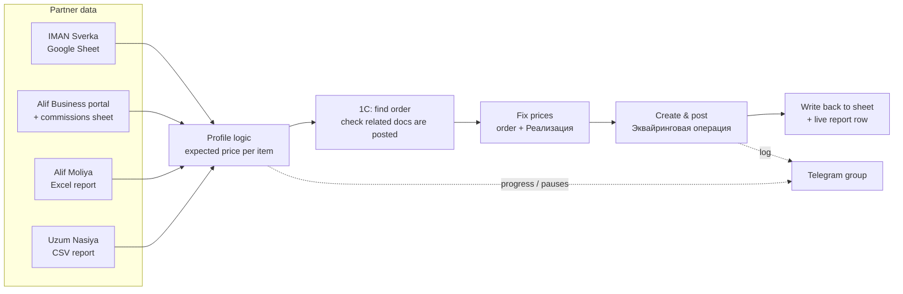

# 1C BNPL Reconciliation

**Robotic reconciliation of installment (BNPL) orders in 1C:Enterprise — reads the partner's source of truth, fixes prices in 1C and posts the acquiring operation, unattended.**


## Overview

A retail & fintech company in Uzbekistan sells goods through several installment / BNPL partners (IMAN, Alif, Uzum Nasiya). For every such sale the accounting system — the **1C:Enterprise "Управление торговлей 11"** desktop client — has to be reconciled with what the partner actually pays: the price on the customer order and on its sales document (Реализация) must match the partner's figure, and an **"Эквайринговая операция"** (acquiring operation) document has to be created and posted.

Done by hand this means opening several documents per order in a desktop UI that has no usable API. This project drives the real 1C client through Windows UI Automation, pulls the reference prices from each partner (Google Sheets, merchant web portals, downloadable reports), applies them, and records every result — so a whole batch can run unattended while progress streams to Telegram.

## Features

- **Four reconciliation profiles** behind one CLI (`--profile`), each with its own 1C agreements and terminal:
  | Profile | Source of truth |
  |---|---|
  | `imanum` | "IMAN Sverka" Google Sheet (amount per order, written back when done) |
  | `alif-shop` | Alif Business portal (application status + items) and a commissions sheet — price = partner price × (1 − commission) |
  | `alif-moliya` | 1C's own list of open orders + an Excel report generated and downloaded from the Alif Business portal |
  | `uzum-nasiya` | 1C's own list of open orders + a CSV report generated and downloaded from the Uzum Nasiya merchant portal |
- **End-to-end 1C automation** with pywinauto: list filters and quick search, related-documents check, price edits in grid cells, posting, creating the acquiring operation from the order.
- **Safety first** — an order is only touched if its related documents are exactly *order + sale* and both are posted (detected with a pixel-colour heuristic, because that tree exposes no UIA state); every post/write asks for confirmation unless `--yes`; unknown dialogs stop the run instead of being guessed at.
- **Multi-item price resolution** — single items, several items matched to sheet rows by quantity, "bonus item" bundles (main item absorbs the difference), delivery lines split out of the partner total and gift lines left as-is (both noted in the report); unsupported shapes are skipped with a reason.
- **Fuzzy product-name matching** tolerant of Cyrillic/Latin look-alike letters and variant suffixes, with a hard cap when model numbers (e.g. `A56`, `256GB`) differ; anything uncertain is escalated to a human.
- **Headed Playwright clients** for the merchant portals: session reuse, report generation, custom date-picker automation, download and parsing.
- **Live reporting** — one row per processed order appended to a Google Sheet as the batch runs.
- **Telegram relay** — console output mirrored to a group; on a pause the operator is tagged and can answer `/continue`, `/skip` or `/quit` from the phone.
- **Self-launching** — starts the 1C thin client and signs in if it isn't already open.
- **Portable .exe builds** (PyInstaller) with a double-click front end and a `--selftest` mode.

## How it works



1. `launch_1c.ensure_1c_open()` makes sure the 1C client is running and logged in.
2. The selected profile collects the orders to process and the expected price for each item.
3. For each order the 1C client is driven step by step: find the order, verify the related documents, set the price on the order and on the sale, post both, then create and post the acquiring operation with the right terminal.
4. The result (success / skipped / partial / error, with a reason) goes to the source sheet where applicable, to the live report sheet and to Telegram.

## Tech stack

| Area | Tools |
|---|---|
| Language | Python 3.11+ |
| Desktop automation | pywinauto (UIA backend), pywin32, comtypes, Pillow (`ImageGrab`) |
| Web automation | Playwright (Chromium, headed) |
| Data | gspread + google-auth (service account), openpyxl, csv |
| Messaging | Telegram Bot API via `requests` |
| Packaging | PyInstaller |

## Project structure

```text
1c-bnpl-reconciliation/
├── automate_order_ekvayring.py   # CLI entry point + reconciliation workflow (all profiles)
├── lib1c.py                      # reusable 1C UI-automation helpers, fuzzy name matching
├── launch_1c.py                  # starts the 1C thin client and signs in if needed
├── env_config.py                 # credentials/.env loader shared by every module
├── sheets_client.py              # IMAN Sverka Google Sheet access (+ 429 retry wrapper)
├── alif_sheets_client.py         # Alif Nasiya applications + commissions sheets
├── alif_client.py                # Alif Business portal client (Playwright)
├── uzum_client.py                # Uzum Nasiya merchant portal client (Playwright)
├── report_sheet.py               # live per-order report sheet
├── telegram_logger.py            # console -> Telegram relay, remote /continue /skip /quit
├── exe_launcher.py               # double-click front end for the .exe builds (+ --selftest)
├── IMAN.py, AlifMoliya.py        # .exe entry points
├── build_exe.bat                 # PyInstaller build of both .exe files
├── README_EXE.txt                # end-user guide for the .exe bundle (RU)
├── requirements.txt
└── .env.example                  # template for credentials/.env
```

## Setup

Requirements: Windows, the 1C:Enterprise 8.3 thin client with access to the target infobase, Python 3.11+.

```powershell
python -m venv venv
venv\Scripts\activate
pip install -r requirements.txt
playwright install chromium

mkdir credentials
copy .env.example credentials\.env      # then fill in real values
# put the Google service-account key at credentials\service_account.json
# and share every Google Sheet used with the key's client_email
```

All settings are read from `credentials/.env` (see `env_config.py`):

| Variable | Used by | Description |
|---|---|---|
| `1c_login`, `1c_password` | `launch_1c.py` | 1C user for automatic sign-in |
| `1c_connection_string` | `launch_1c.py` | Web-published infobase, e.g. `ws=https://<server>/<infobase>;` |
| `1c_window_title_hint` | `lib1c.py` | Company-specific part of the 1C main window title (optional) |
| `1c_thin_client` | `launch_1c.py` | Full path to `1cv8c.exe` if not in the default location (optional) |
| `ALIF_BUSINESS_BASE_URL` | `alif_client.py` | Alif Business portal URL |
| `alifshop_login`, `alifshop_password` | `alif_client.py` | Alif Shop tenant login |
| `alif_moliya_login`, `alif_moliya_password` | `alif_client.py` | Alif Moliya tenant login |
| `UZUM_NASIYA_BASE_URL` | `uzum_client.py` | Uzum Nasiya merchant portal URL |
| `uzum_nasiya_login`, `uzum_nasiya_password` | `uzum_client.py` | Uzum Nasiya login |
| `IMAN_SPREADSHEET_ID`, `IMAN_WORKSHEET_NAME` | `sheets_client.py` | IMAN Sverka sheet and tab |
| `ALIF_SPREADSHEET_ID`, `ALIF_WORKSHEET_GID` | `alif_sheets_client.py` | Alif Nasiya applications sheet and tab gid |
| `COMMISSIONS_SPREADSHEET_ID`, `COMMISSIONS_WORKSHEET_GID` | `alif_sheets_client.py` | Commissions sheet and tab gid |
| `REPORT_SPREADSHEET_URL` | `report_sheet.py` | Live report sheet (URL or id) |
| `logs_bot_token`, `telegram_group_id` | `telegram_logger.py` | Telegram relay (optional) |
| `mention_username` | `telegram_logger.py` | Username tagged on pauses (optional) |

## Usage

```powershell
# IMAN: every unreconciled sheet row from a date onwards, unattended
python automate_order_ekvayring.py --profile imanum --since 01.07.2026 --yes

# IMAN: just the next row, with a confirmation before every post/write
python automate_order_ekvayring.py --profile imanum

# One specific order (optionally forcing the amount / product name)
python automate_order_ekvayring.py --profile imanum --order ON-26/00102
python automate_order_ekvayring.py --profile imanum --order ON-26/00102 --amount 2705080 --product "Galaxy A17 8/256 Gray"

# Alif Shop: one application, or every unresolved row since a date
python automate_order_ekvayring.py --profile alif-shop --application 1000002
python automate_order_ekvayring.py --profile alif-shop --since 01.07.2026 --yes

# Alif Moliya / Uzum Nasiya: every currently open order in 1C (date filter optional)
python automate_order_ekvayring.py --profile alif-moliya --yes
python automate_order_ekvayring.py --profile uzum-nasiya --since 01.07.2026 --yes

# Original fully manual flow for edge cases
python automate_order_ekvayring.py --manual
```

`python automate_order_ekvayring.py --help` lists every flag. While a batch runs, leave the mouse and keyboard alone — the script drives the real 1C window.

To build the portable bundle: `build_exe.bat` (needs PyInstaller) → `dist\1C-Ekvayring\`, then `IMAN.exe --selftest` / `AlifMoliya.exe --selftest` on the target machine.

## Security note

No credentials, IDs or URLs of private resources are stored in the code. Logins, passwords, spreadsheet IDs, the Telegram token and the 1C connection string come from `credentials/.env`; the Google service-account key and saved browser sessions also live in `credentials/`. That folder, `.env` files, downloaded reports and all generated data are excluded by `.gitignore`. Use `.env.example` as the template.

---

**Кратко (RU):** скрипт сверяет заказы рассрочки (IMAN, Alif Shop, Alif Moliya, Uzum Nasiya) в 1С «Управление торговлей»: берёт эталонную цену у партнёра, исправляет цену в заказе и реализации, создаёт и проводит «Эквайринговую операцию». Работает через UI Automation реального клиента 1С, ход работы пишет в Telegram и Google-таблицу.
